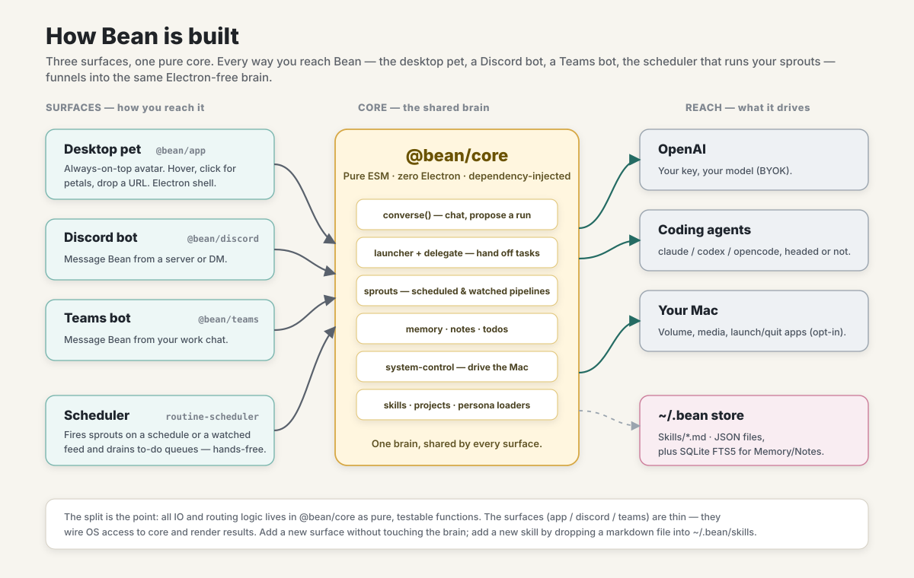

# Bean

<div align="center">
  
  <blockquote>My agent. Knows me, works for me, and only acts when I say go.</blockquote>
</div>

**Bean is my personal agent — a tiny pet that lives on my desktop and gets things done.**

It isn't a harness I drive; it's an agent that works for me. Bean knows who I am,
where my projects live, and how I like things done. It answers what it can on its
own, runs my errands on a schedule, and when a job needs real hands it picks up a
coding agent (`claude`, `codex`, `opencode`) as a tool — always with my
confirmation. No dashboards, no setup files, no ceremony. Just a bean.

Bean is built for one person. Install it and it becomes *your* agent.

> **macOS only, for now.**

---

## What my agent does

🫘 **It's just a chat — until it isn't.**
Ask it anything. Bean answers right there. When something needs actual work, the
same conversation offers to *do* it — and you decide.

🧠 **It remembers you.**
Bean keeps notes as you talk, and on close it offers to save the durable stuff —
about you, your projects, your taste. It gets to know you across sessions, not just
within one.

✅ **You're always in control.**
Nothing runs without a confirmation card: what skill, which project, the exact
prompt — all editable. Hit **Confirm & run** or don't.

🎯 **Drop a link, get the right skill.**
Drag a URL onto the avatar and Bean blooms open its skills, so you drop the link
straight onto the one that should handle it.

🌱 **Grows with you.**
Skills are just markdown files. Adding a new ability is writing a note, not code.
Point Bean at your project folders and it learns where your work lives.

⏰ **Works while you're away.**
Turn any task into a *sprout* — a recurring pipeline on a cron schedule or a watched
feed. The morning digest, the weekly cleanup, the "check this and tell me" job.
Sprouts can chain steps and drain a to-do queue, then drop the result wherever you
want it. Steps can gate on a PASS/FAIL verdict to stop, branch, or loop — start from
an example flow (dev loop, ticket lint first, review only) in the Sprouts panel and
reshape it.

💬 **Reach it from anywhere.**
Wire Bean up to Discord or Teams and message it from your phone or your work chat.
Kick off a task, get an answer, have a sprout post its results back to a channel —
Bean doesn't have to be in front of you to work for you.

🎛️ **Controls your Mac.**
Ask Bean to turn the volume down, mute, skip a track, or launch and quit apps. Opt-in
in Settings, and every action maps to a fixed, validated command — no free-form scripts.

🔌 **Your agent, your key.**
Bean thinks with your own OpenAI key and works through the coding CLIs you already
use. Your key, your models, your machine — nothing runs through someone else's service.

---

## One agent, home and work

The same bean covers both halves of my day:

- **Personal & family** — a morning brief, reminders, a sprout that tidies photos or
  drafts the grocery list, music and volume by voice, notes that remember birthdays and
  preferences.
- **On the job** — let it put `opencode`/`claude`/`codex` to work on a coding task, schedule the standup
  summary, trigger a build from Teams, queue up to-dos and let a sprout work them down.

Set it up once; it quietly covers everything from the family calendar to the sprint.

---

## Getting started

1. **Install Bean.** Grab it from the releases panel.
2. **Open it.** Bean sits on your desktop as a small always-on-top avatar.
   Hover for a box, click for petals — chat, skills, projects, notes.
3. **Add your key.** Open **Settings**, paste your OpenAI key, pick a model.
4. **Say hi.** That's it. Bean bootstraps everything else on first launch.

Set it up entirely from the UI panels — **Settings** (key/model/terminal/editor),
**Persona** (your name and tastes), **Skills**, **Projects**, and **Sprouts**.
Nothing to hand-edit.

## Requirements

- macOS
- Your own OpenAI API key (set it in Settings)
- [`opencode`](https://opencode.ai) and/or `claude`, /`codex` on your `PATH` — for the launch
  modes that hand work to an external agent

---

## For developers

```bash
pnpm install
pnpm dev        # build + launch
pnpm test       # unit tests
```

pnpm-workspace monorepo: `packages/core` (pure logic, zero Electron) + `packages/app`
(Electron shell), plus `packages/discord` and `packages/teams` surfaces. Full
architecture, conventions, and contribution rules live in [`AGENTS.md`](AGENTS.md) —
read it before opening a PR.

---

## How it's built


