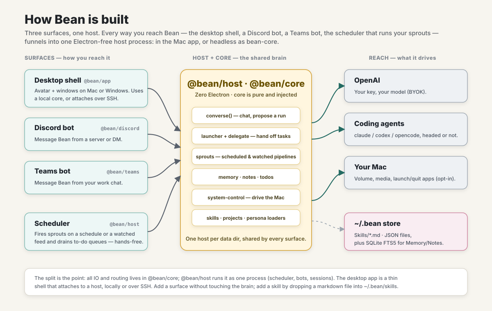

# Bean

<div align="center">
  
  <blockquote>Gets to know you, gets things done, and always asks before it acts.</blockquote>
</div>

**Bean is a personal agent that lives on your desktop as a tiny pet.**

It's not another harness to drive — it's an agent that works for you. Bean learns
who you are, where your projects live, and how you like things done. It answers what
it can on its own, runs errands on a schedule, and when a job needs real hands it
brings in a coding agent (`claude`, `codex`, `opencode`) — always with your OK.
No dashboards, no setup files, no ceremony. Just a bean.

> **The full app is macOS.** On Windows, the desktop app runs as a shell attached to a Bean core
> on another machine (see [Three ways to run Bean](#three-ways-to-run-bean)).

---

## What Bean does

🫘 **It's just a chat — until it isn't.**
Ask it anything. Bean answers right there. When something needs actual work, the
same conversation offers to *do* it — and you decide.

🧠 **It remembers you.**
Bean keeps notes as you talk, and on close it offers to save the durable stuff —
about you, your projects, your taste. It gets to know you across sessions, not just
within one.

✅ **You're always in control.**
Nothing runs without a confirmation card: what skill, which project, the exact
prompt — all editable. Hit **Confirm & run** or don't.

🎯 **Drop a link, get the right skill.**
Drag a URL onto the avatar and Bean blooms open its skills, so you drop the link
straight onto the one that should handle it.

🌱 **Grows with you.**
Skills are just markdown files. Adding a new ability is writing a note, not code.
Point Bean at your project folders and it learns where your work lives.

⏰ **Works while you're away.**
Turn any task into a *sprout* — a recurring pipeline on a cron schedule or a watched
feed. The morning digest, the weekly cleanup, the "check this and tell me" job.
Sprouts can chain steps and drain a to-do queue, then drop the result wherever you
want it. Steps can gate on a PASS/FAIL verdict to stop, branch, or loop — start from
an example flow (dev loop, ticket lint first, review only) in the Sprouts panel and
reshape it.

💬 **Reach it from anywhere.**
Wire Bean up to Discord or Teams and message it from your phone or your work chat.
Kick off a task, get an answer, have a sprout post its results back to a channel —
Bean doesn't have to be in front of you to work for you.

🎛️ **Controls your Mac.**
Ask Bean to turn the volume down, mute, skip a track, or launch and quit apps. Opt-in
in Settings, and every action maps to a fixed, validated command — no free-form scripts.

🔌 **Your key, your machine.**
Bean thinks with your own OpenAI key and works through the coding CLIs you already
use. Nothing runs through someone else's service.

---

## One bean, home and work

The same bean covers both halves of your day:

- **Personal & family** — a morning brief, reminders, a sprout that tidies photos or
  drafts the grocery list, music and volume by voice, notes that remember birthdays and
  preferences.
- **On the job** — let it put `opencode`/`claude`/`codex` to work on a coding task, schedule the standup
  summary, trigger a build from Teams, queue up to-dos and let a sprout work them down.

Set it up once; it quietly covers everything from the family calendar to the sprint.

---

## Getting started

1. **Install Bean.** Grab it from the releases panel.
2. **Open it.** Bean sits on your desktop as a small always-on-top avatar.
   Hover for a box, click for petals — chat, skills, projects, notes.
3. **Add your key.** Open **Settings**, paste your OpenAI key, pick a model.
4. **Say hi.** That's it. Bean bootstraps everything else on first launch.

Set it up entirely from the UI panels — **Settings** (key/model/terminal/editor),
**Persona** (your name and tastes), **Skills**, **Projects**, and **Sprouts**.
Nothing to hand-edit.

## Three ways to run Bean

Bean is two halves: the **core** (the brain, your `~/.bean` data, sprouts, chat bots, the coding
agents it runs) and the **desktop shell** (the avatar and its windows). You choose where the core lives.

1. **Desktop with a local core** (macOS, the default). One app, everything on this Mac.
2. **Headless core.** `bean-core` runs the core with no desktop app — as a launchd/systemd service
   on a dev machine, or in a Docker container. Sprouts, reminders and the Discord/Teams bots keep
   running with no screen. Setup: [`docs/headless.md`](docs/headless.md).
3. **Desktop attached to a remote core.** The desktop app on any Mac or Windows PC attaches to a
   headless core over SSH (no open port). Add the core in the app's **Cores** panel
   (`user@host`, plus the container name if it runs in Docker). The **Windows** app is always this
   mode: it has no local core, so Mac-only features (Mac control, Terminal hand-off, the terminal
   pane) are hidden.

## Requirements

- macOS for the full app; Windows for the remote-only shell
- Your own OpenAI API key (set it in Settings)
- [`opencode`](https://opencode.ai) and/or `claude`, /`codex` on your `PATH` — for the launch
  modes that hand work to an external agent

---

## For developers

```bash
pnpm install
pnpm dev        # build + launch
pnpm test       # unit tests
```

pnpm-workspace monorepo: `packages/core` (pure logic, zero Electron), `packages/host` (the
Electron-free host process — in the app, or headless as `bean-core`), `packages/app` (Electron
shell), plus `packages/discord` and `packages/teams` bot surfaces. Full
architecture, conventions, and contribution rules live in [`AGENTS.md`](AGENTS.md) —
read it before opening a PR.

---

## How it's built


