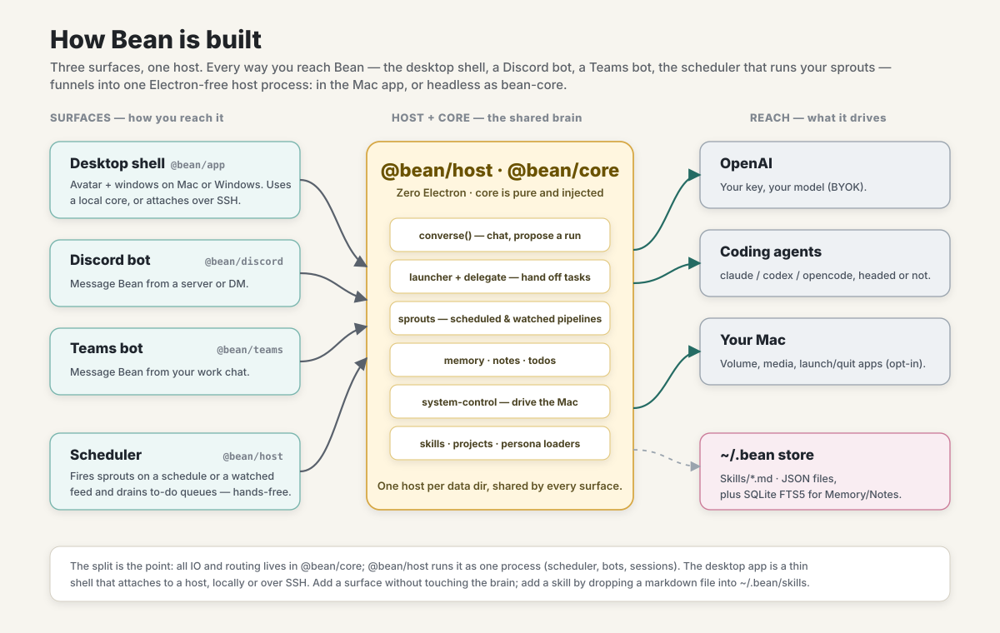

# Superagent Bean

<div align="center">
  
  <blockquote>Gets to know you, gets things done, and always asks before it acts.</blockquote>
  <p><a href="https://scenk.github.io/Bean/"><b>Website</b></a> · <a href="https://scenk.github.io/Bean/#get"><b>Download</b></a> · <a href="docs/headless.md">Headless core</a></p>
</div>

**Bean is a complete personal agent suite that lives on your desktop as a tiny pet — smaller than any IDE or ADE, without even a Dock icon.**

Beside Bean's own Brain (for memory, chat, and routing), **four official coding CLIs** are first-class citizens doing the heavy lifting natively:

| Native CLI | Command | What it brings |
| :--- | :--- | :--- |
|  **Antigravity** | `agy` | Live agent mode, headless delegates, and Sprout steps via Google's official Antigravity CLI |
|  **Claude Code** | `claude` | Streaming live sessions, read-only plan mode, browser skills, and Sprouts via Anthropic's official CLI |
|  **Codex** | `codex` | Live turns, sandboxed read-only planning, delegates, and Sprouts via OpenAI's official Codex CLI |
|  **OpenCode** | `opencode` | Multi-provider model catalog across chat, background delegates, and Sprouts via the official CLI |

- **100% official harnesses — no OAuth proxies, no API billing.** Bean runs the real CLIs already installed and signed in on your machine using your existing subscriptions and logins. *(Only Bean's lightweight Brain uses your own OpenAI key.)*
- **Tiny footprint, full working suite.** On macOS, Bean runs dockless (`LSUIElement`) as a floating pet and menu bar icon — yet packs live multi-agent chat, effortless model switching, a built-in terminal pane, markdown skills, notes, memory + Dream, Discord/Teams ChatOps, and autonomous Sprouts.
- **Autonomous orchestration beyond standalone harnesses.** Sprouts combine zero-token watchers, mixed-CLI step graphs, PASS/FAIL gates with branching and retry loops, session continuation, parallel to-do queues, quiet-by-default sinks, and self-improving retros.

> **The full app is macOS.** On Windows, the desktop app runs as a shell attached to a Bean core
> on another machine (see [Three ways to run Bean](#three-ways-to-run-bean)).

---

## What Bean does

🪶 **Smaller than an IDE — not even a Dock icon.**
No heavy editor chrome or cluttered workspace. Bean stays out of your way as a tiny floating pet and menu bar icon, opening clean windows only when you call them — with a built-in terminal pane right beside your chat and coding agent.

🔀 **Seamless agent & model switching.**
Chat with Bean's Brain, or switch straight into `/agy`, `/claude`, `/codex`, or `/opencode` in the same thread. Swap models from the composer chip, keep remembered defaults per CLI, or assign different harnesses to different steps in a Sprout.

🔌 **Official harnesses — no OAuth, no API billing.**
Every coding harness is the real official CLI on your `PATH`, using the sign-ins and plans you already have. No third-party OAuth bridge, no per-token API markup for agent runs, and no middleman service.

🌱 **Sprouts — full autonomous orchestration.**
Far more complete than single-turn harnesses or brittle cron scripts. Trigger on a cron schedule or a zero-token watch (RSS feed or shell command — no model call per check). Mix **Antigravity**, **Claude Code**, **Codex**, **OpenCode**, Bean **chat**, and deterministic **shell** steps in one pipeline. Gate on a `PASS`/`FAIL` verdict to stop, branch, or loop back with failure context; continue sessions across steps; drain parallel to-do queues; deliver only when needed; and let retro steps draft skill improvements for your review.

✅ **You're always in control.**
Nothing runs without a confirmation card: skill, project, harness/model, exact prompt — all editable. Hit **Confirm & run** or don't.

🧠 **Remembers you — and dreams overnight.**
Bean reads each conversation once it goes quiet and saves what's durable (about you, your projects, your taste) to local SQLite with one-tap Undo. Overnight, **Dream** consolidates duplicates and lets go of stale facts under strict code guardrails.

🎯 **Drop a link, get the right skill.**
Drag a URL, image, or PDF onto the avatar and Bean blooms open its skills, so you drop it straight onto the one that should handle it. Skills are just markdown files — adding a new ability is writing a note, not code.

💬 **Reach it from anywhere.**
Wire Bean up to **Discord** or **Microsoft Teams** and message it from your phone or work chat. Run delegates, host live agent sessions in a channel, carry desktop chats into Discord, or let Sprouts post briefs where you want them.

🎛️ **Controls your Mac.**
Ask Bean to turn the volume down, mute, skip a track, or launch and quit apps. Opt-in in Settings, and every action maps to a fixed, validated command — no free-form scripts.

---

## One bean, home and work

The same bean covers both halves of your day:

- **Personal & family** — a morning brief, reminders, a sprout that tidies photos or
  drafts the grocery list, music and volume by voice, notes that remember birthdays and
  preferences.
- **On the job** — switch effortlessly between **Antigravity** (`agy`), **Claude Code** (`claude`),
  **Codex** (`codex`), and **OpenCode** (`opencode`), schedule standup summaries, trigger builds
  from Discord or Teams, and queue up to-dos for a Sprout to work down autonomously.

Set it up once; it quietly covers everything from the family calendar to the sprint.

---

## Getting started

1. **Install Bean.** Pick your platform on the [download page](https://scenk.github.io/Bean/#get).
2. **Open it.** Bean sits on your desktop as a tiny dockless avatar and menu bar icon.
   Hover for a box, click for petals — chat, skills, projects, notes, sprouts.
3. **Add your Brain key.** Open **Settings**, paste your OpenAI key for Bean's Brain, and pick a model. Bean automatically picks up the official CLIs already on your `PATH`.
4. **Say hi.** That's it. Bean bootstraps everything else on first launch.

Set it up entirely from the UI panels — **Settings**, **Persona**, **Skills**, **Projects**, and **Sprouts**.
Nothing to hand-edit.

## Three ways to run Bean

Bean is two halves: the **core** (the Brain, your `~/.bean` data, sprouts, chat bots, and the four official coding CLIs) and the **desktop shell** (the avatar and its windows). You choose where the core lives.

1. **Desktop with a local core** (macOS, the default). One dockless app, everything on this Mac.
2. **Headless core.** `bean-core` runs the core with no desktop app — as a launchd/systemd service
   on a dev machine, or in a Docker container. Sprouts, reminders and the Discord/Teams bots keep
   running with no screen. Setup: [`docs/headless.md`](docs/headless.md).
3. **Desktop attached to a remote core.** The desktop app on any Mac or Windows PC attaches to a
   headless core over SSH (no open port). Add the core in the app's **Cores** panel
   (`user@host`, plus the container name if it runs in Docker). The **Windows** app is always this
   mode: it has no local core, so Mac-only features (Mac control, Terminal hand-off, the terminal
   pane) are hidden.

## Requirements

- macOS for the full app; Windows for the remote-only shell
- Your own OpenAI API key for Bean's lightweight Brain (set it in Settings)
- One or more official coding CLIs on your `PATH` — signed in directly with your existing accounts (no OAuth proxies or harness API billing):
  -  **Antigravity** (`agy`)
  -  **Claude Code** (`claude`)
  -  **Codex** (`codex`)
  -  **[OpenCode](https://opencode.ai)** (`opencode`)

---

## For developers

```bash
pnpm install
pnpm dev        # build + launch
pnpm test       # unit tests
```

pnpm-workspace monorepo: `packages/core` (pure logic, zero Electron), `packages/host` (the
Electron-free host process — in the app, or headless as `bean-core`), `packages/app` (Electron
shell), plus `packages/discord` and `packages/teams` bot surfaces. Full
architecture, conventions, and contribution rules live in [`AGENTS.md`](AGENTS.md) —
read it before opening a PR.

---

## How it's built


